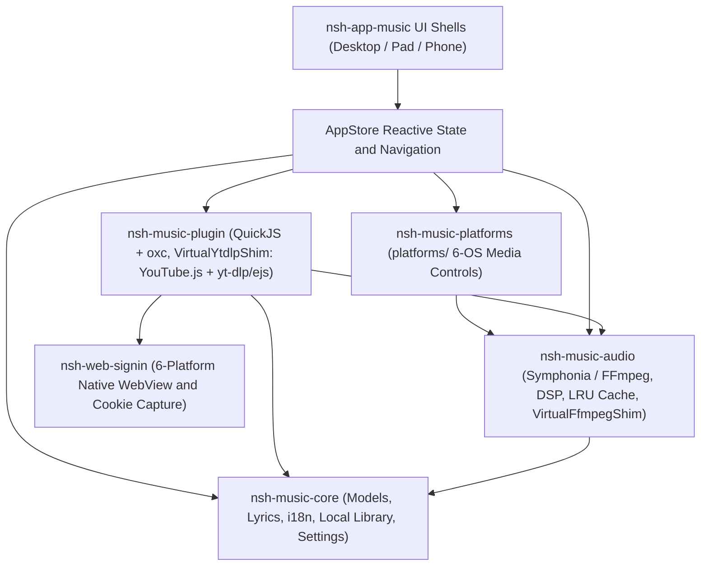

<div align="center">
  
  <h1>NSH Music</h1>
  <p>基于 Rust 与 Native Shell (<code>nsh</code>) 构建的全平台原生音乐播放器</p>
  <p>
    
    
    
    <a href="https://github.com/egoist/mygo-music"></a>
    <a href="./LICENSE"></a>
  </p>
  <p>
    <a href="#特性亮点">特性亮点</a> ·
    <a href="#全平台能力对齐矩阵">全平台矩阵</a> ·
    <a href="#系统架构与工程目录">系统架构</a> ·
    <a href="#插件导入与虚拟化兼容策略">插件安装与兼容策略</a> ·
    <a href="#快速开始与开发指南">快速开始</a> ·
    <a href="#开源协议与致谢">开源协议与致谢</a>
  </p>
</div>

---

## 特性亮点

### 100% 原生渲染 & 三形态自适应

- 零 Electron / Tauri / WebView UI，界面完全由 `nsh` 原生图形管线渲染，原生流畅响应。
- 根据设备类型与视口尺寸自动切换三套交互外壳：
  - **Desktop（桌面端）**：自定义无边框标题栏、可折叠侧边栏、彗星光晕进度条底栏与独立设置子窗口。
  - **Pad（平板端）**：横竖屏自适应导航轨 / 抽屉、悬浮胶囊播控与触控友好命中区。
  - **Phone（手机端）**：安全区顶栏音源切换器、四栏底部导航、悬浮迷你播控与手势沉浸播放页。

### 完整兼容 `mygo-music` 插件生态

- 内置 `quickjs-jit` + `oxc` TypeScript 即时剥离运行时，零构建直接运行上游 JS / TS 插件。
- 完整支持 `plugin.json` 清单、38+ 标准与别名导出函数、`requestHeaders` 域名通配与模板注入、二维码扫码登录，以及六端原生 WebView 登录（含 `HttpOnly` Cookie 采集与手动粘贴回退）。

### 零外部依赖沙箱流媒体引擎

- 内置 **`VirtualFfmpegShim`**，在进程内完成 HTTP / HLS / TS / ID3v2 实时解复用、跨跳转请求头保留与断点重试中继。
- 内置基于上游 **[LuanRT/YouTube.js](https://github.com/LuanRT/YouTube.js)** 与 **[yt-dlp/ejs](https://github.com/yt-dlp/ejs)** 的 **`VirtualYtdlpShim`**，具备字节码中断保护、Worker 自动自愈、有界 LRU 缓存与快速切歌即时取消能力。

### 高保真音频管线与舞台动效

- **本地音乐与解码**：Symphonia 纯 Rust 解码（MP3 / FLAC / WAV / Ogg / Opus / M4A / AAC / ALAC）+ 可选静态 FFmpeg 解码，自动提取内嵌封面与元信息。
- **缓存与音效**：渐进式 LRU 磁盘音频缓存（播放与下载共享）、ReplayGain 响度均衡、Crossfade 交叉淡入淡出及 16 频段实时 FFT 频谱。
- **歌词舞台与视觉模式**：支持逐行 / 逐字同步 **LRC / YRC / QRC**（同目录 `.lrc` 外挂优先，回退内嵌标签）与双语翻译对齐；提供 **`Flow / Steps / Tilt / Wall`** 四种歌词舞台以及 **`Cover / Vinyl（黑胶） / Cassette（磁带）`** 视觉模式。

---

## 全平台能力对齐矩阵

| 平台             | 原生图形与窗口                                                 | 系统媒体控制（锁屏 / 通知栏 / 控制中心）                                      | 外设断开与焦点中断                                             | 插件沙箱与 DeepLink                                                                                     |
| ---------------- | -------------------------------------------------------------- | ----------------------------------------------------------------------------- | -------------------------------------------------------------- | ------------------------------------------------------------------------------------------------------- |
| **macOS**        | AppKit + CoreAudio（无边框标题栏、多窗口、系统托盘与原生菜单） | `MPNowPlayingInfoCenter` + `MPRemoteCommandCenter`                            | CoreAudio 默认输出 / 存活 / 插孔监听（蓝牙与有线断开自动暂停） | `PATH` 自装优先 + 内进程虚拟化回退；`mygo-music://` & `nsh-music://`                                    |
| **Windows**      | Win32 / Direct2D + WASAPI（单实例与系统托盘）                  | WinRT `SystemMediaTransportControls` (`SMTC`)                                 | COM `IMMNotificationClient` 音频端点断开监听                   | `PATH` 自装优先 + 内进程虚拟化回退；`mygo-music://` & `nsh-music://`                                    |
| **Linux**        | GTK 4 + ALSA / PulseAudio（单实例）                            | 零 `pkg-config` 编译依赖的 `MPRIS2` D-Bus (`org.mpris.MediaPlayer2.nshmusic`) | `cpal` 播放期输出设备移除检测（暂停 0% CPU）                   | `PATH` 自装优先 + 内进程虚拟化回退；`mygo-music://` & `nsh-music://`                                    |
| **iOS / iPadOS** | UIKit + CoreAudio（`UIBackgroundModes: audio`）                | `MPNowPlayingInfoCenter` + `MPRemoteCommandCenter` + `AVAudioSession`         | `AVAudioSession` 路由变更与来电 / 焦点中断恢复                 | 全内进程沙箱虚拟化（`YouTube.js + yt-dlp/ejs` / `VirtualFfmpegShim`）；`mygo-music://` & `nsh-music://` |
| **Android**      | Android Views + AAudio / Oboe（媒体播放前台服务权限）          | `MediaSession` + `Notification.MediaStyle`（API 23 / 26 / 33 适配）           | JNI `AudioManager` 外设移除与通话模式中断恢复                  | 全内进程沙箱虚拟化（`YouTube.js + yt-dlp/ejs` / `VirtualFfmpegShim`）；`mygo-music://` & `nsh-music://` |
| **HarmonyOS**    | ArkUI C-API + `OH_AudioRenderer`                               | `AVSession` + `AUDIO_PLAYBACK` 后台长时任务（封面、歌词、收藏与循环同步）     | `OH_AudioRenderer` 系统打断与蓝牙 / 耳机断开回调               | 全内进程沙箱虚拟化（`YouTube.js + yt-dlp/ejs` / `VirtualFfmpegShim`）；`mygo-music://` & `nsh-music://` |

---

## 系统架构与工程目录



| 路径                                               | 说明                                                                                                                                                |
| -------------------------------------------------- | --------------------------------------------------------------------------------------------------------------------------------------------------- |
| `src/`                                             | 应用入口、响应式状态管理（`AppStore`）、三形态外壳（`desktop` 含菜单栏 / 托盘播控、`pad`、`phone`）、页面与 Now Playing 舞台                       |
| `platforms/`                                       | 六端独立原生媒体会话与状态栏集成驱动（`macos` / `ios` / `windows` / `linux` / `android` / `harmonyos`，含构建期 Java 桥接编译）                     |
| `crates/nsh-music-core`                            | 核心数据模型、`MusicSource` 协议、LRC / YRC / QRC 歌词解析、本地音频扫描、`zh-CN` / `en` 国际化、设置与会话原子持久化                               |
| `crates/nsh-music-audio`                           | 跨平台音频引擎、Symphonia / FFmpeg 解码、ReplayGain / Crossfade / FFT DSP、渐进式 LRU 缓存、`VirtualFfmpegShim`、远程控制桥接与设备断开监听         |
| `crates/nsh-music-plugin`                          | QuickJS + `oxc` 插件运行时、`plugin.json` 与权限校验、`requestHeaders` 规则展开、`VirtualYtdlpShim`（内嵌 `YouTube.js` + `yt-dlp/ejs`）             |
| `crates/nsh-web-signin`                            | 六端原生 WebView 登录与 `HttpOnly` Cookie 采集模块                                                                                                  |
| [`docs/PLUGIN_COMPAT.md`](./docs/PLUGIN_COMPAT.md) | 38+ 导出函数兼容矩阵、`host.*` 接口参考、内进程虚拟化架构与移动端插件迁移指南                                                                       |
| [`DESIGN.md`](./DESIGN.md)                         | 跨平台设计系统、三形态布局规范与动效清单                                                                                                            |

---

## 插件导入与虚拟化兼容策略

### 4 种插件安装方式

1. **网页一键拉起（DeepLink）**：点击插件站点的 `mygo-music://install-plugin?repo=owner/repo`（同时兼容 `mygo-music-dev://` 与 `nsh-music://`）直接拉起应用并弹出权限确认框。
2. **GitHub 仓库导入**：在「设置 → 插件」输入 `owner/repo` 或 `owner/repo@ref`（亦支持完整 GitHub URL）。
3. **ZIP 压缩包导入**：导入本地 `.zip` 插件包，内置 Zip-Slip 路径穿越安全防护。
4. **本地目录导入 / 窗口拖放**：选择本地插件目录，或在桌面端直接将插件目录 / ZIP 拖放到应用窗口。

### 「移动端虚拟化兼容」开关策略

可在「设置 → 插件 → **移动端虚拟化兼容（Mobile Virtualization Compatibility）**」按需切换执行策略。**NSH Music 绝不静默自动下载任何外部二进制文件。**

| 开关状态         | 桌面端（macOS / Windows / Linux）                                                                                                                                         | 移动端（iOS / Android / HarmonyOS）                                                                             |
| ---------------- | ------------------------------------------------------------------------------------------------------------------------------------------------------------------------- | --------------------------------------------------------------------------------------------------------------- |
| **开启（默认）** | 自动优先使用用户在系统 `PATH` 中自行安装的 `yt-dlp` / `ffmpeg`（已授予外部程序权限时）；未安装时无缝回退至内进程 **`YouTube.js + yt-dlp/ejs`** 与 **`VirtualFfmpegShim`** | 直接在应用沙箱内运行内进程 **`YouTube.js + yt-dlp/ejs`** 与 **`VirtualFfmpegShim`**，零 Python / 外部命令行依赖 |
| **关闭**         | 跳过内进程虚拟化，所有命令直通系统 `PATH` 外部二进制，失败时在对应插件卡片展示错误提示                                                                                    | 跳过内进程虚拟化，直通系统 `PATH` 调用并在受沙箱限制时于插件卡片返回明确错误                                    |

详细兼容细节与迁移指南请参阅 [`docs/PLUGIN_COMPAT.md`](./docs/PLUGIN_COMPAT.md)。

---

## 快速开始与开发指南

### 前置条件

- **Rust 工具链**（`edition = "2024"`）
- 移动端运行与全平台打包需安装 `nsh` CLI 及对应目标平台 SDK（Xcode / Android NDK / DevEco Studio OHOS SDK 等）

### 常用命令

```bash
# 桌面端本地编译并运行（macOS / Windows / Linux）
cargo run

# 全工作区严格静态检查（零警告）
cargo clippy --workspace --all-targets -- -D warnings

# 运行全工作区单元测试与无头流测试（本地回环测试绕过系统代理）
NO_PROXY=127.0.0.1,localhost cargo test --workspace

# 使用 NSH CLI 在目标平台运行（macos / windows / linux / ios / android / harmonyos）
nsh run --target <platform>

# 使用 NSH CLI 打包对应平台原生安装包
nsh package --target <platform>
```

### CI 与多平台自动发布流水线

仓库通过 GitHub Actions 提供完整的持续集成与多平台发布流水线：

- **持续集成（[`.github/workflows/ci.yml`](./.github/workflows/ci.yml)）**：在 `push`（`main`）、`pull_request` 及手动触发时自动运行格式检查（`cargo fmt --all -- --check`），在 **macOS / Linux / Windows** 三端执行零警告 `cargo clippy --workspace --all-targets --locked -- -D warnings` 与单元测试，并在 **HarmonyOS (`aarch64-unknown-linux-ohos`)** 上执行跨平台 `clippy` 静态检查。
- **多平台自动发布（[`.github/workflows/release.yml`](./.github/workflows/release.yml)）**：推送 `v*` 标签（如 `git tag v0.1.0 && git push origin v0.1.0`）自动构建全平台产物并发布 GitHub Release（含 `SHA256SUMS.txt`）；也可在 Actions 页面通过 **`workflow_dispatch`** 按需选择单平台或全平台构建（留空 `tag` 仅上传工作流产物，填写已有 `tag` 则同步发布至对应 Release）。

| 平台目标                       | 自动构建产物                                                                                                   |
| ------------------------------ | -------------------------------------------------------------------------------------------------------------- |
| **macOS (`arm64`)**            | `NSH-Music-v<ver>-macos-arm64.dmg`（拖拽安装）+ `NSH-Music-v<ver>-macos-arm64.app.tar.gz`                      |
| **Windows (`x86_64`/`arm64`)** | `NSH-Music-v<ver>-windows-<arch>-setup.exe`（Inno Setup 安装器）+ `-portable.zip`                              |
| **Linux (`x86_64`/`arm64`)**   | `NSH-Music-v<ver>-linux-<arch>.AppImage` + `NSH-Music-v<ver>-linux-<arch>.tar.gz`                              |
| **Android**                    | `NSH-Music-v<ver>-android-arm64-v8a.apk` + `NSH-Music-v<ver>-android-universal.apk`（`arm64-v8a` + `x86_64`）  |
| **HarmonyOS (`arm64`)**        | `NSH-Music-v<ver>-harmonyos-arm64.hap`（基于 `nsh-platform-harmonyos 0.7` + `ohpm-rs` + `@ohos-rs/arkdown`）   |

- **零签名密钥要求**：CI 构建无需配置任何签名 Secrets——Android 使用 `nsh` 内置密钥打包可直接安装的 `.apk`，macOS 采用 ad-hoc 签名，HarmonyOS 输出未签名 `.hap`。
- **iOS 说明**：iOS 非越狱真机无法直接安装未签名 `.ipa`（需要付费 Apple Developer 证书与设备 UDID Ad-Hoc / Enterprise / TestFlight 描述文件），因此默认不包含在公开 GitHub Actions 流水线中，请按需在本地配置签名后构建。

---

## 开源协议与致谢

NSH Music 的界面交互设计、插件清单与 Host / Plugin RPC 兼容规范，以及 `mygo-music://` DeepLink 协议均深受 **[egoist/mygo-music](https://github.com/egoist/mygo-music)**（作者：EGOIST）启发并与之保持生态兼容。

上游项目 `egoist/mygo-music` 采用 **GNU Affero General Public License v3.0 (AGPL-3.0)** 开源（参见其 [`LICENSE`](https://github.com/egoist/mygo-music/blob/main/LICENSE)）。遵循 AGPL-3.0 的传染性开源（Copyleft）条款，**NSH Music 同样以 [GNU Affero General Public License v3.0 (AGPL-3.0)](./LICENSE) 许可协议开源分发**。

### 第三方内嵌与参考开源组件

| 项目                                                                  | 开源协议 (SPDX)                                                                          | 在 NSH Music 中的用途                                                                                                                |
| --------------------------------------------------------------------- | ---------------------------------------------------------------------------------------- | ------------------------------------------------------------------------------------------------------------------------------------ |
| [egoist/mygo-music](https://github.com/egoist/mygo-music)             | `AGPL-3.0`                                                                               | UI / UX 交互参考、`plugin.json` 与 Host/Plugin RPC 兼容规范、`mygo-music://` DeepLink 协议                                           |
| [LuanRT/YouTube.js](https://github.com/LuanRT/YouTube.js)             | `MIT`                                                                                    | 内嵌于 `VirtualYtdlpShim`（运行在 `quickjs-jit` 并桥接至 Rust `reqwest`），提供上游维护的 YouTube / YouTube Music InnerTube 解析能力 |
| [yt-dlp/yt-dlp](https://github.com/yt-dlp/yt-dlp)                     | `The Unlicense`（OSI/FSF 认证公有领域开源协议）                                          | `VirtualYtdlpShim` 的 CLI 参数兼容与格式选择策略参考                                                                                 |
| [yt-dlp/ejs](https://github.com/yt-dlp/ejs)（PyPI 包名 `yt-dlp-ejs`） | `The Unlicense`（OSI/FSF 认证公有领域开源协议；内含 `MIT` 协议的 `meriyah` / `astring`） | 内嵌于插件兼容层，在无外部 JS 运行时环境下离线求解播放器签名（`sig`）与节流（`n`）挑战                                               |
