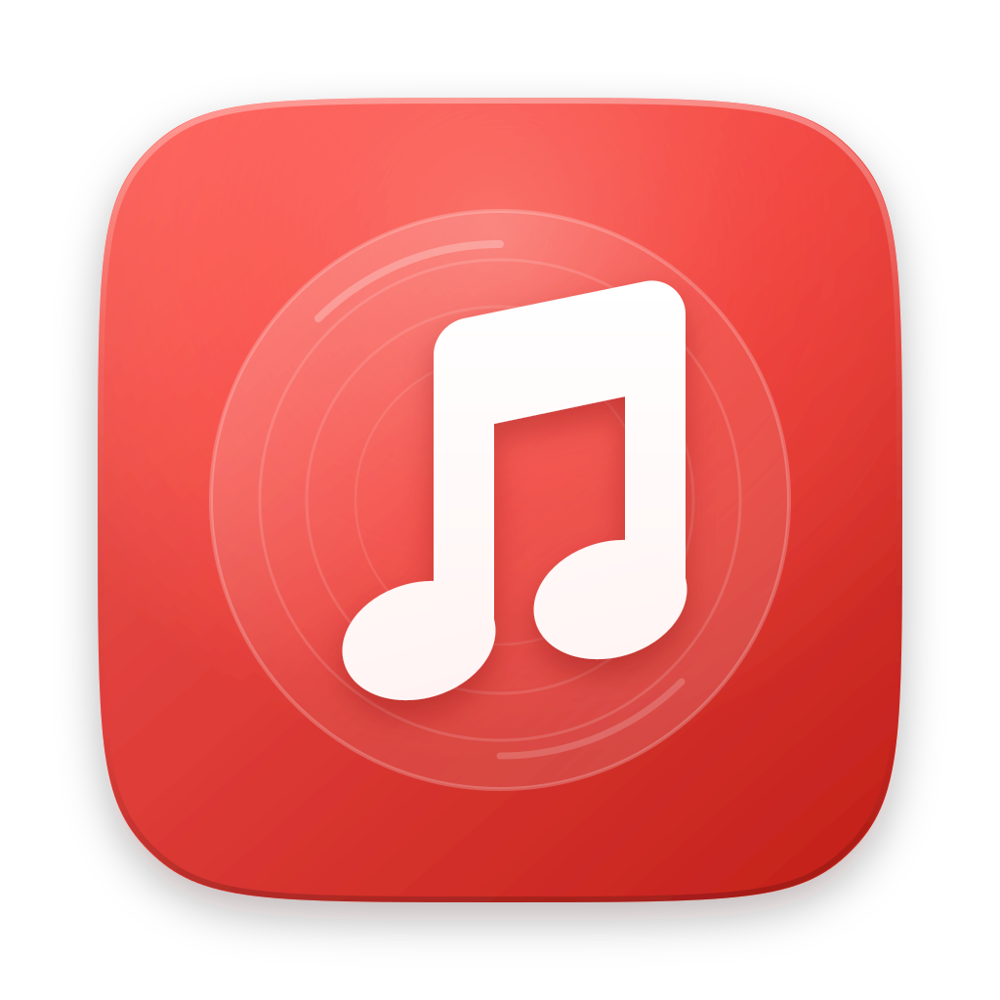

<div align="center">
  
  <h1>NSH Music</h1>
  <p>A 100% native cross-platform music player built with Rust and Native Shell (<code>nsh</code>)</p>
  <p>
    <strong>English</strong> · <a href="./README.zh-CN.md">简体中文</a>
  </p>
  <p>
    <a href="https://github.com/richerfu/nsh-music/actions/workflows/ci.yml"></a>
    <a href="https://github.com/richerfu/nsh-music/releases"></a>
    
    
    
    <a href="https://github.com/egoist/mygo-music"></a>
    <a href="./LICENSE"></a>
  </p>
  <p>
    <a href="#features">Features</a> ·
    <a href="#platform-matrix">Platform Matrix</a> ·
    <a href="#architecture">Architecture</a> ·
    <a href="#plugin-compatibility">Plugin Compatibility</a> ·
    <a href="#downloads--build">Downloads &amp; Build</a> ·
    <a href="#license--credits">License &amp; Credits</a>
  </p>
</div>

---

## Features

### 100% Native Rendering & 3 Adaptive Shells

- Zero Electron, Tauri, or WebView UI — every screen is rendered natively through `nsh`'s native graphics pipeline with platform-appropriate HIG adaptive icons across all six operating systems.
- Automatically adapts layout and interaction ergonomics across three dedicated shells:
  - **Desktop**: Frameless custom titlebar, collapsible sidebar, comet-glow scrubber bar, dedicated Settings window, macOS menu-bar live synced-lyric title, and cross-platform system-tray playback controls.
  - **Pad**: Landscape/portrait adaptive navigation rail & drawer, floating pill playback dock, and touch-sized (`>= 44pt`) controls.
  - **Phone**: 4-edge safe-area layout with live IME / keyboard avoidance, top-bar source switcher, 4-tab bottom navigation, floating mini-player, and gesture-driven Now Playing sheet.

### Complete `mygo-music` Plugin Ecosystem

- Built-in `quickjs-jit` + `oxc` on-the-fly TypeScript stripping runtime executes upstream JS / TS plugins directly with zero build step.
- Full support for `plugin.json` manifests, 38+ canonical & alias exports, wildcard `requestHeaders` template injection, Web Fetch (`ReadableStream` streaming bodies & `redirect: "error"`), streaming `TextDecoder`, Web Crypto, QR code sign-in, and 6-OS native WebView sign-in with `HttpOnly` cookie capture and manual cookie-paste fallback.

### Zero-External-Dependency Sandboxed Media Engine

- **`VirtualFfmpegShim`**: In-process HTTP / HLS / MPEG-TS / ID3v2 real-time demuxing and relay with cross-redirect header preservation and reconnect-resilient streaming.
- **`VirtualYtdlpShim`**: Powered by embedded upstream **[LuanRT/YouTube.js](https://github.com/LuanRT/YouTube.js)** and **[yt-dlp/ejs](https://github.com/yt-dlp/ejs)**, featuring bytecode interrupt protection, automatic worker self-healing, bounded LRU caches, and instant cancellation on rapid track skips.

### High-Fidelity Audio & Caching Pipeline

- **Decoding & Local Library**: Pure-Rust **Symphonia** decoding (`MP3 / FLAC / WAV / Ogg / Opus / M4A / AAC / ALAC`) plus optional static **FFmpeg** decoding, with automatic embedded artwork and metadata extraction.
- **Caching & DSP**: Track-keyed LRU disk audio cache with loopback stream persistence and full next-track prefetch, SWR (stale-while-revalidate) catalog / lyrics / artwork caches, ReplayGain loudness normalization, smooth Crossfade, and 16-band real-time FFT spectrum visualization.
- **Lyrics Stages & Visual Modes**: Line- and word-synced **LRC / YRC / QRC** and structured lyrics (prioritizing local sidecar `.lrc` files over embedded tags) with bilingual translation/romaji alignment; **`Flow / Steps / Tilt / Wall`** lyrics stages and **`Cover / Vinyl / Cassette`** Now Playing visual modes.

---

## Platform Matrix

| Platform | Native UI, Icons & Audio | System Media Controls (Lock Screen / Tray / Notifications) | Peripheral Disconnect & Focus Interruption | Plugin Sandbox & Deep Links |
| --- | --- | --- | --- | --- |
| **macOS** | AppKit + CoreAudio (frameless titlebar, multi-window, menu-bar live lyric title, template tray & HIG macOS icon) | `MPNowPlayingInfoCenter` + `MPRemoteCommandCenter` + native menu-bar / tray controls | CoreAudio default-output / alive / jack listener (auto-pause on Bluetooth or wired unplug) | `PATH` user binaries first + in-process virtualization fallback; `mygo-music://` & `nsh-music://` |
| **Windows** | Win32 / Direct2D + WASAPI (single instance, in-memory color system tray & HIG Windows icon) | WinRT `SystemMediaTransportControls` (`SMTC`) + system-tray playback controls | COM `IMMNotificationClient` audio endpoint disconnect monitor | `PATH` user binaries first + in-process virtualization fallback; `mygo-music://` & `nsh-music://` |
| **Linux** | GTK 4 + ALSA / PulseAudio (single instance, color system tray & HIG Linux icon) | Zero-`pkg-config` `MPRIS2` D-Bus (`org.mpris.MediaPlayer2.nshmusic`) + system-tray controls | `cpal` active-playback output-device removal detection (`0%` CPU while paused) | `PATH` user binaries first + in-process virtualization fallback; `mygo-music://` & `nsh-music://` |
| **iOS / iPadOS** | UIKit + CoreAudio (`UIBackgroundModes: audio`, 4-edge safe areas & live IME avoidance) | `MPNowPlayingInfoCenter` + `MPRemoteCommandCenter` + `AVAudioSession` | `AVAudioSession` route-change & call / focus interruption recovery | Full in-process sandbox virtualization (`YouTube.js + yt-dlp/ejs` & `VirtualFfmpegShim`); `mygo-music://` & `nsh-music://` |
| **Android** | Android Views + AAudio / Oboe (`FOREGROUND_SERVICE_MEDIA_PLAYBACK`, Android 13+ `POST_NOTIFICATIONS`, Adaptive & Material You icons) | Build-time compiled `NshMediaBridge.java` -> `MediaSession` + `Notification.MediaStyle` (API 23 / 26 / 33+) | JNI `AudioManager` peripheral removal & call-focus interruption recovery | Full in-process sandbox virtualization (`YouTube.js + yt-dlp/ejs` & `VirtualFfmpegShim`); `mygo-music://` & `nsh-music://` |
| **HarmonyOS** | ArkUI C-API + `OH_AudioRenderer` (`nsh-platform-harmonyos 0.7`, `KEEP_BACKGROUND_RUNNING`) | `AVSession` + `AUDIO_PLAYBACK` continuous background task (synced artwork, lyrics, favorite & loop state) | `OH_AudioRenderer` system interruption & Bluetooth / headset disconnect callbacks | Full in-process sandbox virtualization (`YouTube.js + yt-dlp/ejs` & `VirtualFfmpegShim`); `mygo-music://` & `nsh-music://` |

---

## Architecture


| Path | Description |
| --- | --- |
| `src/` | Application entry point, reactive state store (`AppStore`), 3 adaptive shells (`desktop` with menu-bar lyric & tray controls, `pad`, `phone`), pages, and Now Playing stages |
| `platforms/` | `nsh-music-platforms` workspace crate with 6 dedicated OS directories (`macos`, `ios`, `windows`, `linux`, `android`, `harmonyos`); compiles `platforms/android/java/com/richerfu/nshmusic/NshMediaBridge.java` to DEX via `build.rs` at build time (zero committed `.dex` binaries) |
| `crates/nsh-music-core` | Core domain models, `MusicSource` trait, LRC / YRC / QRC & structured lyrics parser, local library scanner, `en` / `zh-CN` i18n, atomic settings & session persistence |
| `crates/nsh-music-audio` | Cross-platform audio engine, Symphonia / optional static FFmpeg decoding, ReplayGain / Crossfade / 16-band FFT DSP, track-keyed LRU disk cache & next-track prefetch, `VirtualFfmpegShim`, remote-control bridge, and output-disconnect listeners |
| `crates/nsh-music-plugin` | QuickJS + `oxc` JS/TS plugin runtime, `plugin.json` manifest & permission enforcement, `requestHeaders` wildcard expansion, Web Fetch / `TextDecoder` / Web Crypto polyfills, and `VirtualYtdlpShim` (`YouTube.js` + `yt-dlp/ejs`) |
| `crates/nsh-web-signin` | 6-platform native WebView sign-in and `HttpOnly` cookie capture crate |
| [`docs/PLUGIN_COMPAT.md`](./docs/PLUGIN_COMPAT.md) | 38+ export compatibility matrix, `host.*` API reference, in-process virtualization architecture, and mobile plugin migration guide |
| [`DESIGN.md`](./DESIGN.md) | Cross-platform design system, 3-form-factor layout specification, and motion inventory |

---

## Plugin Compatibility

### 4 Installation Methods

1. **One-Click Deep Link**: Open `mygo-music://install-plugin?repo=owner/repo` (also supports `mygo-music-dev://` and `nsh-music://`) from any browser to launch NSH Music and preview requested permissions before installing.
2. **GitHub Repository**: Enter `owner/repo`, `owner/repo@ref`, or a full GitHub URL under **Settings -> Plugins**.
3. **ZIP Archive**: Import a local `.zip` plugin bundle with built-in Zip-Slip path-traversal protection.
4. **Local Folder / Drag & Drop**: Pick a local plugin directory, or drag and drop a plugin folder / `.zip` directly onto the desktop window.

### Mobile Virtualization Compatibility Policy

Configure execution routing under **Settings -> Plugins -> Mobile Virtualization Compatibility**. **NSH Music never silently downloads external binaries.**

| Toggle State | Desktop (macOS / Windows / Linux) | Mobile (iOS / Android / HarmonyOS) |
| --- | --- | --- |
| **Enabled (Default)** | Prefers user-installed `yt-dlp` / `ffmpeg` on system `PATH` when process permission is granted; seamlessly falls back to in-process **`YouTube.js + yt-dlp/ejs`** and **`VirtualFfmpegShim`** when absent | Runs in-process **`YouTube.js + yt-dlp/ejs`** and **`VirtualFfmpegShim`** directly inside the app sandbox with zero Python or external CLI dependencies |
| **Disabled** | Bypasses in-process virtualization and invokes system `PATH` binaries directly, surfacing clear error banners on the plugin card if missing or failing | Bypasses in-process virtualization and invokes system `PATH` directly, reporting sandbox/command errors cleanly on the plugin card |

See [`docs/PLUGIN_COMPAT.md`](./docs/PLUGIN_COMPAT.md) for the complete compatibility matrix and migration guide.

---

## Downloads & Build

### Prebuilt Releases

Download prebuilt binaries and `SHA256SUMS.txt` directly from **[GitHub Releases](https://github.com/richerfu/nsh-music/releases)**.

| Release Target | Published Artifacts |
| --- | --- |
| **macOS (`arm64`)** | `NSH-Music-v<ver>-macos-arm64.dmg` (drag-to-Applications) + `NSH-Music-v<ver>-macos-arm64.app.tar.gz` |
| **Windows (`x86_64`)** | `NSH-Music-v<ver>-windows-x86_64-setup.exe` (Inno Setup installer) + `NSH-Music-v<ver>-windows-x86_64-portable.zip` |
| **Windows (`arm64`)** | `NSH-Music-v<ver>-windows-arm64-setup.exe` (Inno Setup installer) + `NSH-Music-v<ver>-windows-arm64-portable.zip` |
| **Linux (`x86_64`)** | `NSH-Music-v<ver>-linux-x86_64.AppImage` + `NSH-Music-v<ver>-linux-x86_64.tar.gz` |
| **Linux (`arm64`)** | `NSH-Music-v<ver>-linux-arm64.AppImage` + `NSH-Music-v<ver>-linux-arm64.tar.gz` |
| **Android** | `NSH-Music-v<ver>-android-arm64-v8a.apk` + `NSH-Music-v<ver>-android-universal.apk` (`arm64-v8a` + `x86_64`) |
| **HarmonyOS (`arm64`)** | `NSH-Music-v<ver>-harmonyos-arm64.hap` (built via `nsh-platform-harmonyos 0.7` + `ohpm-rs` + `@ohos-rs/arkdown`) |

### CI & Automated Release Pipelines

- **Continuous Integration ([`.github/workflows/ci.yml`](./.github/workflows/ci.yml))**: Runs `cargo fmt --all -- --check`, zero-warning `cargo clippy --workspace --all-targets --locked -- -D warnings` & unit tests on **macOS / Linux / Windows**, and cross-platform `clippy` for **HarmonyOS (`aarch64-unknown-linux-ohos`)**.
- **Multi-Platform Releases ([`.github/workflows/release.yml`](./.github/workflows/release.yml))**: Pushing a `v*` tag (e.g. `git tag v0.1.0 && git push origin v0.1.0`) builds all 7 targets above and publishes a GitHub Release with `SHA256SUMS.txt`. Also supports manual `workflow_dispatch` for single-target or full-matrix runs.
- **Zero-Secrets CI**: Public workflows require zero signing secrets — Android signs directly installable `.apk` files with `nsh`'s built-in keystore, macOS uses ad-hoc signing, and HarmonyOS produces an unsigned `.hap` (sign locally with DevEco Studio to install on real HarmonyOS devices).
- **iOS Note**: Non-jailbroken iOS devices strictly reject unsigned `.ipa` packages (`nsh package --target ios` requires both an Apple Developer signing identity and a provisioning profile), so iOS is omitted from public CI and built locally with your own signing credentials.

### Quick Start (Local Development)

**Prerequisites**: Rust toolchain (`edition = "2024"`), plus `nsh` CLI and target platform SDKs (Xcode, Android SDK/NDK + JDK 17, or DevEco Studio OHOS SDK) when running on mobile or packaging installers.

```bash
# Build and run on desktop (macOS / Windows / Linux)
cargo run

# Strict workspace lint check (zero warnings)
cargo clippy --workspace --all-targets -- -D warnings

# Run workspace unit and headless UI flow tests (bypass system proxy for loopback tests)
NO_PROXY=127.0.0.1,localhost cargo test --workspace

# Run on a target platform via NSH CLI (macos / windows / linux / ios / android / harmonyos)
nsh run --target <platform>

# Package native installers / bundles via NSH CLI
nsh package --target <platform>
```

---

## License & Credits

NSH Music's UI/UX design language, plugin manifest & Host/Plugin RPC specification, and `mygo-music://` deep-link protocol are heavily inspired by and ecosystem-compatible with **[egoist/mygo-music](https://github.com/egoist/mygo-music)** (by EGOIST).

Because upstream `egoist/mygo-music` is licensed under the **GNU Affero General Public License v3.0 (AGPL-3.0)** (see its [`LICENSE`](https://github.com/egoist/mygo-music/blob/main/LICENSE)), **NSH Music is likewise licensed and distributed under the [GNU Affero General Public License v3.0 (AGPL-3.0)](./LICENSE)** in full compliance with AGPL-3.0 copyleft requirements.

### Open-Source Components & Ecosystem Acknowledgments

| Project | License (SPDX) | Role in NSH Music |
| --- | --- | --- |
| [egoist/mygo-music](https://github.com/egoist/mygo-music) | `AGPL-3.0` | UI/UX design inspiration, `plugin.json` & Host/Plugin RPC compatibility contract, `mygo-music://` deep-link protocol |
| [LuanRT/YouTube.js](https://github.com/LuanRT/YouTube.js) | `MIT` | Embedded inside `VirtualYtdlpShim` (executed in `quickjs-jit` bridged to Rust `reqwest`) for upstream-maintained YouTube / YouTube Music InnerTube resolution |
| [yt-dlp/yt-dlp](https://github.com/yt-dlp/yt-dlp) | `The Unlicense` | CLI flag compatibility and audio format-selection reference for `VirtualYtdlpShim` |
| [yt-dlp/ejs](https://github.com/yt-dlp/ejs) (`yt-dlp-ejs`) | `The Unlicense` (bundles `MIT`-licensed `meriyah` / `astring`) | Embedded challenge solver for offline player signature (`sig`) and throttle (`n`) decryption without an external JS runtime |
| [longbridge/nsh](https://github.com/longbridge/nsh) | `Apache-2.0` | Native Shell (`nsh`) cross-platform native UI framework, runtime, and multi-platform packaging CLI |
| [nsh-platform-harmonyos](https://crates.io/crates/nsh-platform-harmonyos) | `Apache-2.0` | HarmonyOS ArkUI C-API backend, `AVSession` bridge, and `.hap` project generator for NSH 0.7 |
| [harmony-contrib/ohpm-rs](https://github.com/harmony-contrib/ohpm-rs) | Upstream CI tool (not linked) | Fast Rust OHPM dependency installer invoked during HarmonyOS CI packaging |
| [@ohos-rs/arkdown](https://www.npmjs.com/package/@ohos-rs/arkdown) | `MIT OR Apache-2.0` | Rust-based OpenHarmony / HarmonyOS `.hap` packager invoked in CI release builds |
