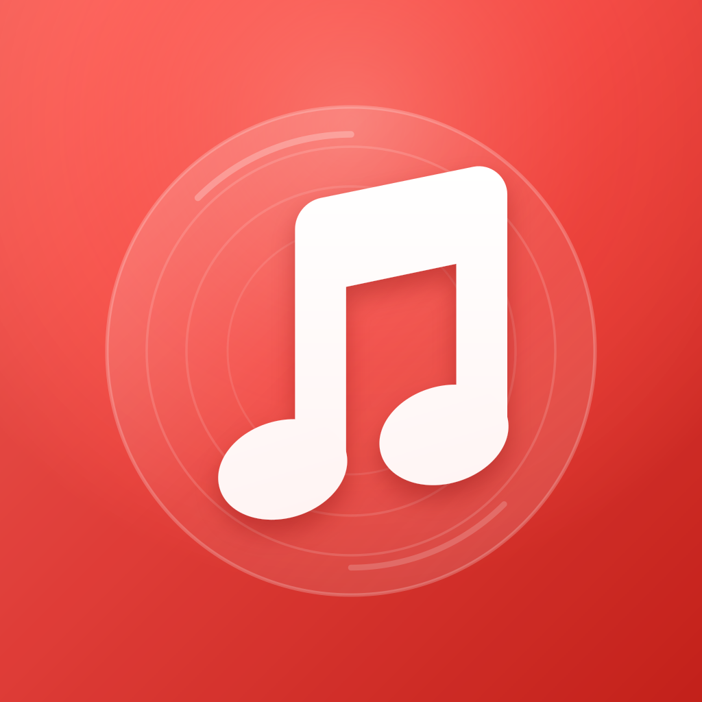

<div align="center">
  
  <h1>NSH Music</h1>
  <p>基于 Rust 与 Native Shell (<code>nsh</code>) 构建的跨平台原生音乐播放器</p>
  <p>
    <strong>macOS · Windows · Linux · iOS · Android · HarmonyOS</strong><br />
    零 WebView UI · Desktop / Pad / Phone 三形态自适应 · 完整兼容 <code>mygo-music</code> 插件生态
  </p>
  <p>
    <a href="./LICENSE">GNU AGPL v3.0</a> ·
    <a href="./docs/PLUGIN_COMPAT.md">插件兼容性与移动端迁移指南</a>
  </p>
</div>

---

## 简介

**NSH Music** 是一款完全使用 Rust 编写、基于 Native Shell (`nsh`) 渲染引擎构建的跨平台原生音乐播放器。应用界面全部由原生图形管线渲染（不依赖 Electron / Tauri / WebView UI），开箱支持 **macOS、Windows、Linux、iOS、Android、HarmonyOS** 六大操作系统，并针对 **Desktop（桌面端）、Pad（平板端）、Phone（手机端）** 自动切换符合人体工学的布局与交互体验。

## 核心特性

- **本地音乐库**
  - 支持扫描本地文件夹中的 **MP3、FLAC、WAV、Ogg/Opus、M4A/AAC/ALAC** 音频文件，自动解析元信息与内嵌专辑封面。
  - 歌词加载优先匹配同目录 `.lrc` / `.LRC` 外挂歌词文件，并回退读取音频标签内嵌歌词；支持本地歌单增删改查。
- **完整兼容 [egoist/mygo-music](https://github.com/egoist/mygo-music) 插件生态**
  - 内置 QuickJS (`quickjs-jit`) + `oxc` TypeScript 运行时，兼容 `plugin.json` 清单、38+ 标准与别名导出函数、`requestHeaders` 域名匹配与模板变量展开、二维码扫码登录以及原生 WebView 会话登录（支持 `HttpOnly` Cookie 获取与手动回退）。
  - 支持通过 **`mygo-music://install-plugin?repo=owner/repo`**（同时兼容 `mygo-music-dev://` 与 `nsh-music://`）DeepLink 一键拉起应用并导入插件，也支持 GitHub 仓库、本地目录、ZIP 压缩包与窗口拖放安装。
- **移动端沙箱内进程兼容层**
  - 内置 **`VirtualFfmpegShim`**、**`VirtualYtdlpShim`** 与内嵌 **`yt-dlp-ejs`**，在 iOS / Android / HarmonyOS 沙箱及未安装外部命令行工具的桌面环境中透明拦截并执行 `ffmpeg` / `yt-dlp` 调用，实现零外部二进制依赖的流媒体解析与 HLS/DASH 中继。
  - 可在「设置 → 插件」中通过 **移动端虚拟化兼容（Mobile Virtualization Compatibility）** 开关自由切换内进程虚拟化与系统 `PATH` 外部命令调用。完整架构与兼容矩阵请参见 [`docs/PLUGIN_COMPAT.md`](./docs/PLUGIN_COMPAT.md)。
- **高质量音频引擎与沉浸式播放页**
  - 内置渐进式 LRU 磁盘音频缓存与瞬断重试/断点续传机制，播放、切歌与下载共享缓存。
  - 支持 Symphonia 纯 Rust 解码与可选静态 FFmpeg 解码、**ReplayGain** 响度均衡、**Crossfade** 交叉淡入淡出 DSP，以及 16 频段实时 FFT 音频频谱。
  - 支持逐行及逐字同步 **LRC / YRC / QRC** 歌词解析与翻译/音译时间轴对齐；提供 **`Flow` / `Steps` / `Tilt` / `Wall`** 歌词舞台动效，以及 **`Cover`（封面）/ `Vinyl`（黑胶唱机）/ `Cassette`（磁带机）** 多种播放视觉模式。
- **六端原生系统媒体控制与音频外设联动**
  - 全平台对接系统通知栏、锁屏与控制中心媒体控件：
    - **macOS / iOS**：`MPNowPlayingInfoCenter` + `MPRemoteCommandCenter`（iOS 自动激活 `AVAudioSession` 后台音频播放）
    - **Windows**：WinRT `SystemMediaTransportControls` (`SMTC`)
    - **Linux**：零 `pkg-config` 编译依赖的 `MPRIS2` D-Bus 服务 (`org.mpris.MediaPlayer2.nshmusic`)
    - **Android**：`MediaSession` + `Notification.MediaStyle`
    - **HarmonyOS**：`AVSession` + 后台音频长时任务
  - 全平台支持有线耳机拔出、蓝牙设备断开自动暂停及系统来电/音频焦点中断处理。

## 工程结构

| 路径                      | 说明                                                                                                                                               |
| ------------------------- | -------------------------------------------------------------------------------------------------------------------------------------------------- |
| `src/`                    | 应用入口、响应式状态管理 (`AppStore`)、三形态外壳 (`desktop` / `pad` / `phone`)、页面 UI、Now Playing 舞台与六端原生媒体会话驱动 (`src/platform/`) |
| `crates/nsh-music-core`   | 数据模型、`MusicSource` 协议、LRC/YRC/QRC 歌词解析、本地音频扫描、`zh-CN`/`en` 国际化、设置与会话持久化                                            |
| `crates/nsh-music-audio`  | 跨平台音频引擎、Symphonia/FFmpeg 解码、DSP、LRU 缓存、`VirtualFfmpegShim`、远程控制桥接与设备断开监听                                              |
| `crates/nsh-music-plugin` | QuickJS + `oxc` 插件运行时、`plugin.json` 解析、权限与 `requestHeaders` 处理、`VirtualYtdlpShim` + `yt-dlp-ejs` 兼容层                             |
| `crates/nsh-web-signin`   | 六端原生 WebView 登录与 `HttpOnly` Cookie 采集模块                                                                                                 |
| `docs/PLUGIN_COMPAT.md`   | 插件接口兼容矩阵、移动端虚拟化架构与迁移指南                                                                                                       |

## 开发与构建

### 前置条件

- Rust 工具链（`edition = "2024"`）
- 打包移动端或各平台发行产物时需安装 `nsh` CLI 及对应平台 SDK（Xcode / Android NDK / DevEco Studio OHOS SDK 等）

### 常用命令

```bash
# 桌面端本地编译并运行（macOS / Windows / Linux）
cargo run

# 运行完整工作区测试（本地回环测试建议绕过系统代理）
NO_PROXY=127.0.0.1,localhost cargo test --workspace

# 使用 NSH CLI 在目标平台运行（macos / windows / linux / ios / android / harmonyos）
nsh run --target <platform>

# 使用 NSH CLI 打包对应平台原生安装包
nsh package --target <platform>
```

## 开源协议与致谢 (License & Attribution)

- **致谢 [egoist/mygo-music](https://github.com/egoist/mygo-music)**（作者：EGOIST）：
  NSH Music 的界面交互设计、插件清单与 Host/Plugin RPC 兼容规范，以及 `mygo-music://` DeepLink 协议均深受 `mygo-music` 启发并与之保持生态兼容。
- **开源协议（AGPL-3.0）**：
  上游项目 [`egoist/mygo-music`](https://github.com/egoist/mygo-music) 采用 **GNU Affero General Public License v3.0 (AGPL-3.0)** 开源（参见其 [`LICENSE`](https://github.com/egoist/mygo-music/blob/main/LICENSE)）。遵循 AGPL-3.0 的传染性开源条款要求，**NSH Music** 同样依据 **[GNU Affero General Public License v3.0](./LICENSE)** 许可协议发布与分发。
- **内进程兼容层第三方参考与内嵌组件**：
  - **[yt-dlp](https://github.com/yt-dlp/yt-dlp)**（Unlicense）：`VirtualYtdlpShim` 的流媒体提取行为与客户端策略参考了 `yt-dlp`。
  - **[yt-dlp/ejs](https://github.com/yt-dlp/ejs)**（PyPI 包名 `yt-dlp-ejs`，Unlicense；包含 MIT 协议的 `meriyah` / `astring`）：内嵌于插件兼容层，用于在无外部 JS 运行时的环境中离线求解签名/节流挑战。
